

  

 

I'm **Calebe**, a software developer and **Analysis & Systems Development** student at **Unieuro**, based in Brazil.
I build back-end systems and AI-powered tools, from multi-agent decision engines to full-stack dashboards.

As part of Unieuro's **Scientific Initiation** program, I research **Large Language Models** and **multi-agent systems**, turning research ideas into tested, working software with Python and the Hugging Face ecosystem.

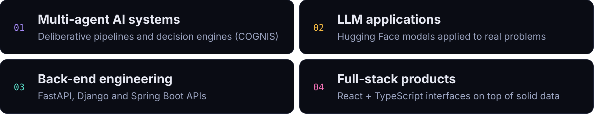

 

  

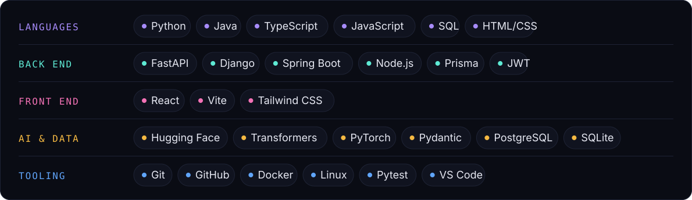

 

  <a href="https://github.com/SpellmanKing/COGNIS"></a>
  <a href="https://github.com/SpellmanKing/Infra_AI"></a>
  <a href="https://github.com/SpellmanKing/dashboard-senac-labs"></a>
  <a href="https://github.com/SpellmanKing/mapa-sala"></a>
  <a href="https://github.com/SpellmanKing/Back_Starfit"></a>
  <a href="https://github.com/SpellmanKing/Avaliador-Filmes-e-Sentimentos"></a>

More on my <a href="https://github.com/SpellmanKing?tab=repositories">repositories page</a>.

 

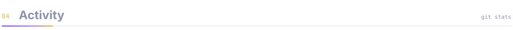


<picture>
  <source media="(prefers-color-scheme: dark)" srcset="https://raw.githubusercontent.com/SpellmanKing/SpellmanKing/output/snake-dark.svg" />
  <source media="(prefers-color-scheme: light)" srcset="https://raw.githubusercontent.com/SpellmanKing/SpellmanKing/output/snake.svg" />
  
</picture>

 

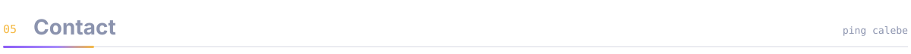

  
  
  

Open to collaborating on AI, back-end and research projects.

 

  

